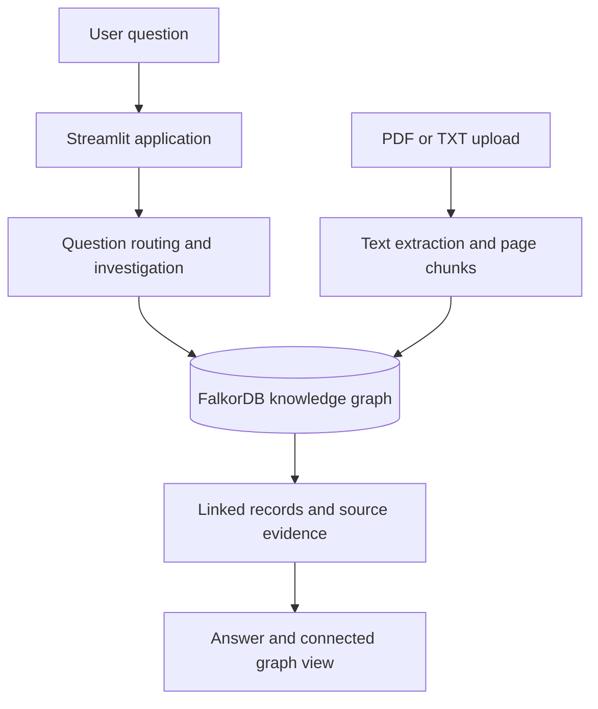

# Knowlattice

**The intelligence behind how your company works.**

Knowlattice is a graph-based company intelligence prototype that connects projects, people, decisions, tickets, messages, and documents so teams can investigate what is happening and inspect the evidence behind an answer.

Instead of looking at individual records in isolation, Knowlattice uses relationships stored in a FalkorDB knowledge graph to help answer questions about project ownership, decisions, and blockers.

## Features

- **Project investigation** — inspect a project's status and linked records.
- **Ownership tracing** — identify recorded project owners and people responsible for decisions.
- **Decision tracing** — explore approved decisions and their recorded makers.
- **Blocker investigation** — connect project status, tickets, and related messages.
- **Document ingestion** — upload PDF or UTF-8 TXT documents and associate their page-level text with a project.
- **Evidence and provenance** — inspect supporting records, source identifiers, document names, and page numbers.
- **Knowledge graph visualization** — explore relationships between projects, people, decisions, tickets, messages, and documents.
- **Evidence-aware answers** — distinguish recorded facts from a root cause that the available evidence does not establish.

## Example questions

Using the included demo graph, try asking:

- `What is blocking Atlas Migration?`
- `Who owns Atlas Migration?`
- `What decision was made about Atlas Migration?`
- `What evidence supports this answer for Atlas Migration?`

The demo graph contains a fictional project called **Atlas Migration**, an approved PostgreSQL 17 migration decision, an associated ticket, and a chat message about schema validation.

## How it works



The current prototype uses deterministic question routing, graph queries, and keyword-based document passage ranking. It is designed to make evidence inspectable rather than present an unverified explanation as fact.

## Technology stack

- Python
- Streamlit
- FalkorDB
- PyPDF
- pytest

## Getting started

### Prerequisites

- Python and `pip`
- Podman or Docker
- Git

### 1. Clone the repository

```bash
git clone https://github.com/happy2234/knowlattice.git
cd knowlattice
```

### 2. Create a Python environment

```bash
python3 -m venv .venv
source .venv/bin/activate
python -m pip install --upgrade pip
python -m pip install -r requirements.txt
```

### 3. Start FalkorDB

Using Podman:

```bash
podman run -d \
  --name knowlattice-falkordb \
  -p 127.0.0.1:6379:6379 \
  -p 127.0.0.1:3000:3000 \
  -v knowlattice_data:/data \
  docker.io/falkordb/falkordb:latest
```

The application expects FalkorDB at `localhost:6379`. The database container stores its data in a persistent volume.

If FalkorDB is already running on that port, use the existing instance instead of starting another container.

### 4. Initialize the demo graph

For a **fresh demo graph**, run:

```bash
python -m src.seed_graph
python -m src.extend_graph
```

**Warning:** `src.seed_graph` deletes the existing nodes in the `knowlattice` graph before recreating the sample graph. Running it again will erase graph data stored there, including ingested documents. Only use it when setting up or intentionally resetting a demo.

The seed and extension scripts create the sample project, people, decision, ticket, message, and relationships.

### 5. Launch Knowlattice

```bash
streamlit run app.py
```

Open the local URL printed by Streamlit, usually `http://localhost:8501`.

### 6. Upload a document

Use the document upload section in the app and associate a PDF or UTF-8 TXT file with a known project.

Current ingestion limits:
- Maximum upload size: 20 MB
- Supported files: PDF and TXT
- Scanned PDFs without extractable text are not processed by OCR

Uploaded documents are stored in the knowledge graph. Keep sensitive company documents out of public repositories and only upload material you are authorized to process.

## Run the tests

From the repository root, with the Python environment activated:

```bash
python -m pytest -q
```

## Repository structure

```text
knowlattice/
├── app.py
├── requirements.txt
├── README.md
├── src/
│   ├── agent.py
│   ├── answer.py
│   ├── company_brain.py
│   ├── extend_graph.py
│   ├── ingest_documents.py
│   ├── investigate.py
│   ├── query_graph.py
│   ├── relationships.py
│   └── seed_graph.py
└── tests/
```

## Security and data handling

- Keep database ports bound to localhost for local development.
- Do not commit credentials, private company data, or confidential documents.
- Uploaded documents and local environment files are excluded from version control by the repository's ignore rules.
- The included project records are a demonstration dataset, not verified real-world company data.

## Current limitations

Knowlattice is an evolving prototype. Answers depend on the records currently stored in the graph and the passages retrieved from uploaded documents. The available evidence may identify a reported blocker without proving its underlying cause.

## License

No license file has been added yet. The repository's reuse and distribution terms have not been specified by a license.
